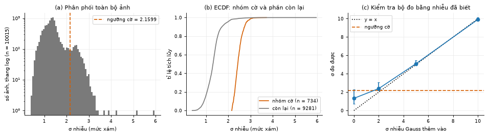
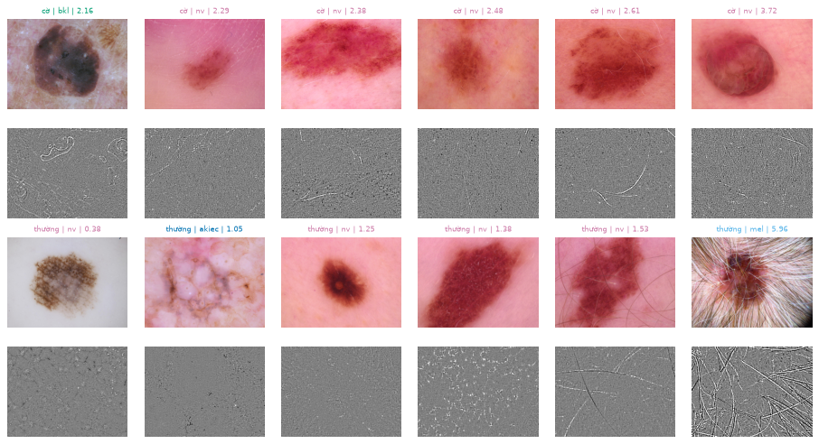
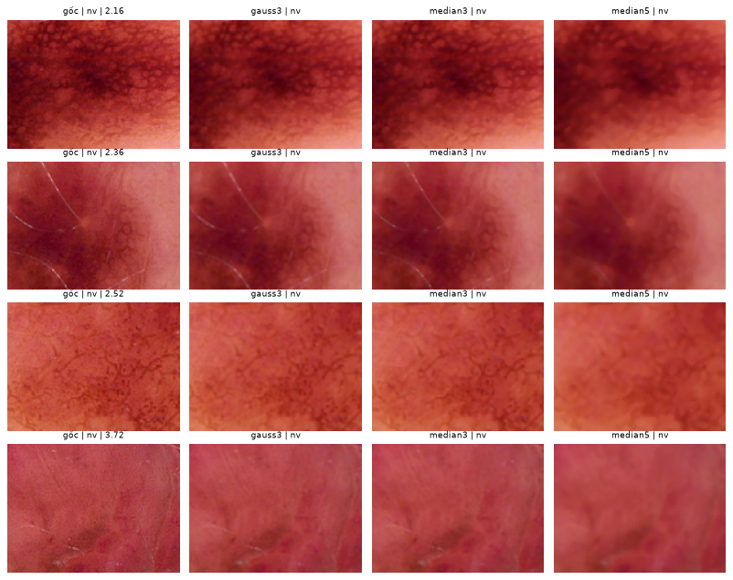
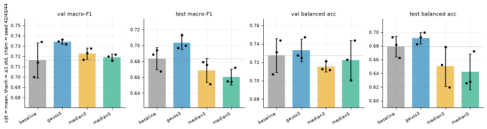
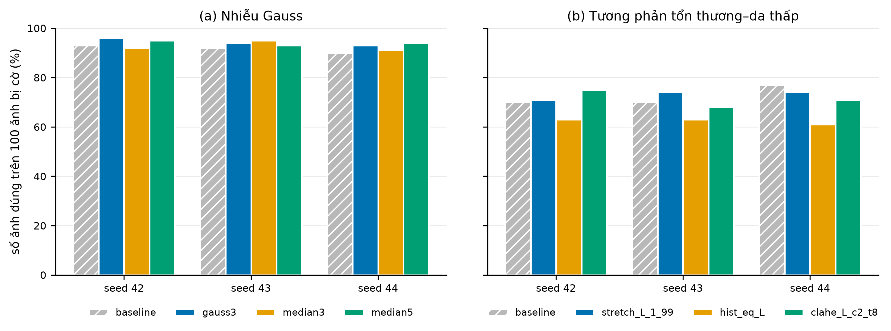
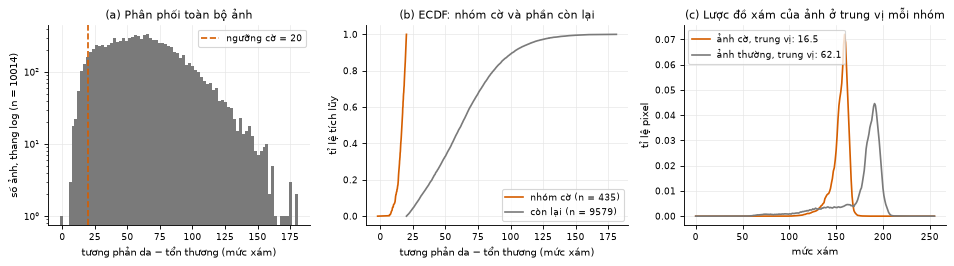
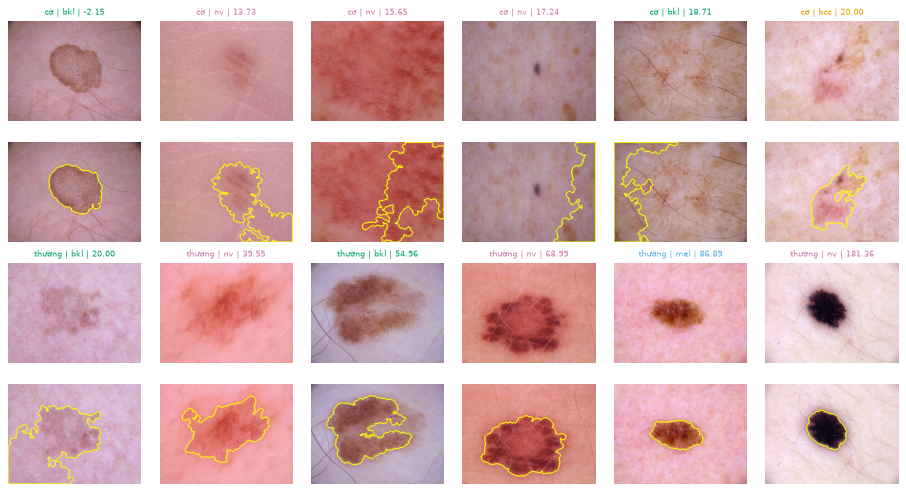
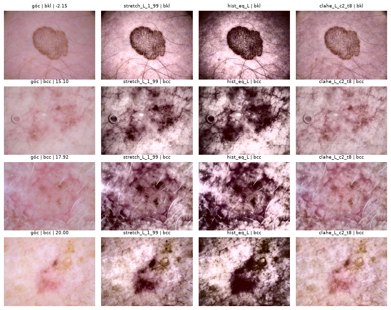
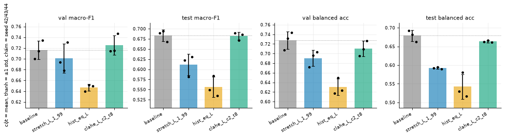

# Đánh giá tác động của xử lý ảnh lên phân loại bệnh da bằng CNN: mở đầu và phần nhiễu Gauss, tương phản thấp

> **Lưu ý đồng bộ số liệu chính thức (10/11/2026):** Tệp này lưu lại bản biên soạn nhánh riêng ban đầu của Duy Anh & Dũng trước khi cả nhóm gộp nhánh và chạy lại thống nhất toàn bộ 17 cấu hình trên một GPU **NVIDIA L40S** duy nhất. Bản báo cáo chính thức đã đồng bộ 100% số liệu của phần này nằm tại [`reports/2.5a_nhieu_tuong_phan.md`](2.5a_nhieu_tuong_phan.md) và [`overleaf/BaoCao_XuLyAnh_HAM10000.pdf`](../overleaf/BaoCao_XuLyAnh_HAM10000.pdf).
>
> **Nguồn số liệu phần Mở đầu.** `reports/2.1_du_lieu.md`, `2.2_eda_chat_luong_anh.md`, `2.3_chuan_bi_du_lieu.md`, `2.4_baseline.md` và mục 1–2 của notebook 2.5.3–2.5.6.
>
> **Nguồn số liệu từ mục 1 trở đi.** Số CNN lấy từ output đã lưu trong hai notebook, là lượt chạy ngày 09/11/2026 của Dũng trên RTX 3050. Bảng đo ảnh `Δab` và bảng theo 5 phép lọc lấy từ `reports/2.5a_nhieu_tuong_phan.md`. Cột "đo" ở Bảng 3 và số ở mục 6 do `scripts/report_noise_contrast.py` sinh ra.
> **Chưa làm:** chưa train lại. Máy biên soạn báo cáo không có `archive/`, `outputs/`, GPU CUDA. Chạy lại thì số sẽ lệch (mục 3).

## Mở đầu

### Đề tài

Đề tài của nhóm là *Đánh giá các tác động của các phương pháp xử lý ảnh lên mô hình phân loại bệnh trên bộ dữ liệu chụp thực tế sử dụng mạng nơ-ron tích chập*, gắn với Chương 3 (nâng cao chất lượng ảnh) và Chương 8 (phân loại ảnh) của học phần.

### Bài toán

Phân loại ảnh tổn thương da vào 7 lớp `akiec`, `bcc`, `bkl`, `df`, `mel`, `nv`, `vasc`. Dữ liệu là HAM10000 (Tschandl và cộng sự, 2018; bản tải từ Kaggle), gồm 10 015 ảnh của 7 470 tổn thương, mọi ảnh đều 600×450, RGB. Đây là ảnh chụp qua máy soi da (dermoscopy) trong thực hành lâm sàng, không phải ảnh điện thoại.

### Vấn đề

1. **Mất cân bằng lớp.** `nv` có 6 705 ảnh, `df` có 115 ảnh, chênh 58,3 lần. Một bộ phân loại luôn đoán `nv` đạt accuracy 66,92% trên test nhưng macro-F1 chỉ 0,1145, nên nhóm dùng macro-F1 làm chỉ số chính.
2. **Một tổn thương có nhiều ảnh.** 1 956 tổn thương (26,2%) có từ 2 ảnh trở lên, chiếm 44,9% số ảnh. Vì vậy dữ liệu được chia theo `lesion_id`: train 6 408, validation 1 603, test 2 004 ảnh.
3. **Chất lượng ảnh không đồng đều.** Đây là trọng tâm của đề tài: ảnh có lông, viền đen ống soi, quá sáng, sáng không đều, nhiễu, hoặc tổn thương lẫn vào da.

### Mục tiêu

Mục tiêu không phải xây dựng mô hình có độ chính xác cao nhất, mà là lập luận, thực nghiệm và đánh giá: các phép xử lý ảnh cổ điển có thực sự giúp CNN phân loại tốt hơn không, và giúp ở đâu. Kết quả không cải thiện hoặc tệ hơn vẫn được báo cáo.

Nhóm cố định một mô hình là ResNet-18 pretrained. Baseline chỉ resize 224×224 và chuẩn hóa, đạt macro-F1 test 0,6805 ± 0,0192 trên 3 seed (mục 2.4). Mỗi thí nghiệm chỉ thêm đúng một bước xử lý ảnh và so với baseline của cùng lượt chạy. Vì vậy phần của Duy Anh và Dũng dùng baseline lượt chạy lại là 0,6837 ± 0,0141 (mục 3 bên dưới).

### Sáu vấn đề và phân công

EDA đo chất lượng trên toàn bộ 10 015 ảnh và xác định 6 vấn đề có bằng chứng. Quá tối (40 ảnh) và nhiễu muối–tiêu (1 ảnh) quá ít nên không xử lý riêng.

| Vấn đề | Số ảnh bị cờ | Quy tắc gắn cờ | Phương pháp đã thử | Notebook | Phụ trách |
|---|---|---|---|---|---|
| Lông che phủ | 1 016 (10,1%) | Tỉ lệ pixel lông > 5,82% | Black-hat 17×17 + inpainting Telea: `hair_bh17`, `hair_bh17_cond` | `2.5.3_long.ipynb` | Sơn, Ngọc |
| Viền tối do ống soi | 355 (3,5%) | Vùng đen nối mép ảnh > 1% diện tích | Tô viền bằng màu da `vig_fill`; cắt viền `vig_crop` | `2.5.6_vien_toi.ipynb` | Sơn, Ngọc |
| Quá sáng (bạc màu) | 302 (3,0%) | Pixel "trắng bạc" > 10% vùng nhìn thấy | Gamma trên L\*: `gamma_L_1.5`, `gamma_L_auto` | `2.5.5_qua_sang.ipynb` | Sơn, Ngọc |
| Sáng không đều | 247 (2,5%) | Chênh nền giữa các ô > 38 mức xám | Hiệu chỉnh nền trên L\*, Gauss σ = 60: `flat_L_s60`, `flat_L_s60_cond` | `2.5.4_sang_khong_deu.ipynb` | Sơn, Ngọc |
| **Nhiễu Gauss** | **734 (7,33%)** | σ > 2,16 mức xám | `gauss3`, `median3`, `median5` | `2.5.1_nhieu_gauss.ipynb` | **Dũng, Duy Anh** |
| **Tương phản tổn thương–da thấp** | **435 (4,34%)** | Chênh da–tổn thương < 20 mức xám | `stretch_L_1_99`, `hist_eq_L`, `clahe_L_c2_t8` | `2.5.2_tuong_phan_thap.ipynb` | **Dũng, Duy Anh** |

Trong mỗi cặp, một người dựng code và chạy thực nghiệm, một người phụ trách lý thuyết và giải thích kết quả. Từ đây trở đi là phần của Duy Anh và Dũng: Dũng dựng code và chạy thực nghiệm; Duy Anh phụ trách lý thuyết, giải thích kết quả và trình bày.

## 1. Tóm tắt phần của Duy Anh và Dũng

| | Nhiễu Gauss | Tương phản thấp |
|---|---|---|
| **Notebook** | `2.5.1_nhieu_gauss.ipynb` | `2.5.2_tuong_phan_thap.ipynb` |
| **Có nhóm ảnh gặp vấn đề không?** | Có, nhưng mức nhiễu nhỏ: 734/10 015 ảnh (7,33%) có σ > 2,16 mức xám | Có: 435/10 015 ảnh (4,34%) có chênh da–tổn thương < 20. Mask ước lượng sai ở 10/24 ảnh đã soát |
| **Phương pháp đã thử** | `gauss3`, `median3`, `median5` | `stretch_L_1_99`, `hist_eq_L`, `clahe_L_c2_t8` |
| **Sửa được ảnh không?** | Có: σ ở 224 của nhóm cờ giảm từ 0,861 xuống 0,597 với `gauss3` | Tùy phép: chênh da–tổn thương từ 16,5 lên 100,4 (`hist_eq_L`), chỉ lên 19,9 (CLAHE) |
| **Test macro-F1 so với baseline** (0,6837 ± 0,0141, 3 seed) | Cả 3 "không khác biệt rõ": Δ +0,0200 / −0,0148 / −0,0232 | `hist_eq_L` Δ −0,1274 và `stretch_L_1_99` Δ −0,0724 "tệ hơn rõ"; CLAHE Δ −0,0011 "không khác biệt rõ" |
| **Tác động riêng lên nhóm cờ** | CI95 của DiD chứa 0 ở 6/6 so sánh | CI95 của DiD chứa 0 ở 6/6 so sánh |
| **Quyết định cho pipeline** | Không đưa khử nhiễu vào | Không đưa tăng tương phản vào |

**Thông điệp chính:** các phép xử lý thay đổi đúng chỉ số trên ảnh, nhưng không có cấu hình nào cải thiện được phân loại ở mức đo được. Kết quả âm này vẫn là kết quả, đúng với mục đích đề tài là lập luận và đánh giá.

## 2. Mục tiêu và file liên quan

### 2.1 Mục tiêu của phần này

Theo mục 2.5 của kế hoạch nhóm, với mỗi vấn đề cần: chứng minh bộ dữ liệu có nhóm ảnh gặp vấn đề; nêu phương pháp và lý do; so sánh ảnh trước/sau; giữ nguyên baseline và chỉ thêm tiền xử lý; kiểm tra accuracy trên tập ảnh có vấn đề; chạy ít nhất 3 lần, vẽ biểu đồ cột; giải thích kết quả.

### 2.2 Dũng đã làm gì và nằm ở đâu

Hai notebook đi theo cùng một khuôn và gọi chung một bộ hàm, nên hai vấn đề được xử lý bằng đúng một quy trình.

| Mục notebook | Nội dung |
|---|---|
| 1. Mô tả vấn đề | Định nghĩa, vì sao có thể hại hoặc không hại CNN, cách đo |
| 2. Chứng minh vấn đề | Phân phối chỉ số, bằng chứng không vòng tròn, ảnh minh họa chọn có hệ thống |
| 3. Nhóm ảnh gặp phải | Tỉ lệ theo lớp, vùng cơ thể, cách gán nhãn, tuổi, giới; chi-square, Cramér's V |
| 4. Tỉ lệ | Số ảnh bị cờ theo từng tập; độ nhạy theo ngưỡng |
| 5. Phương pháp | Bảng cấu hình, giả thuyết, ảnh trước/sau, đo trên ảnh |
| 6. Thực nghiệm | Baseline + 3 cấu hình × 3 seed, so ghép cặp, theo lớp, tác động riêng lên nhóm cờ |
| 7. Mẫu 100 ảnh | Đúng/sai trước và sau trên 100 ảnh bị cờ, có đối chứng dao động giữa seed |
| 8. Nhận xét | Quan sát, đối chiếu giả thuyết, diễn giải, hạn chế, quyết định |

| Vai trò | File |
|---|---|
| Phép xử lý ảnh | `src/preprocess/noise.py`, `src/preprocess/contrast.py` |
| Danh sách cấu hình | `src/preprocess/__init__.py` |
| Quy trình dùng chung của hai notebook | `src/preprocess/problem_report.py` |
| Huấn luyện | `scripts/run_problem_experiments.py` gọi `src/training.py` |
| So sánh với baseline, kiểm định | `src/preprocess/compare.py`, `src/preprocess/subgroup.py` |
| Đo ảnh trước/sau | `src/preprocess/image_metrics.py` |
| Bộ đo và quy tắc gắn cờ của EDA | `src/eda/quality_metrics.py`, `src/eda/flags.py` |
| Kết quả gốc (chỉ có trên máy Dũng) | `outputs/rerun_2.5/`, `outputs/figures/rerun_2.5/` |

### 2.3 Đối chiếu với yêu cầu

| Yêu cầu | Trạng thái | Ở đâu |
|---|---|---|
| Xác định phương pháp, notebook, lý thuyết để trình bày | Xong | Mục 2.2, 4.3, 5.3, 7 |
| Chứng minh có nhóm ảnh gặp vấn đề | Xong, có hạn chế đã nêu | Mục 4.2, 5.2 |
| Phương pháp và lý do; ảnh trước/sau | Xong | Mục 4.3–4.4, 5.3–5.4 |
| Giữ baseline, chỉ thêm tiền xử lý, 3 seed | Xong | Mục 3 |
| Accuracy trên tập ảnh có vấn đề | Xong một phần: toàn nhóm cờ chỉ có trung bình 3 seed; theo từng seed mới có trên mẫu 100 ảnh | Mục 4.5, 5.5 |
| Biểu đồ cột so sánh 3 lần chạy | Xong một phần: macro-F1 có; accuracy tập con mới có trên mẫu 100 ảnh | Hình 4, 5, 9; mục 6.3 |
| Phán đoán, giải thích | Xong | Mục 4.6, 5.6 |

## 3. Thiết kế thí nghiệm chung

- **Biến thay đổi:** đúng một bước xử lý ảnh. Giữ nguyên ResNet-18 pretrained, 224×224, AdamW lr 1e-4, batch 32, 20 epoch, WeightedRandomSampler, flip, split theo `lesion_id`.
- **Vị trí xử lý:** ở 600×450, trước resize và Normalize, giống nhau cho train, val, test. Mọi phép chỉ dùng thống kê của chính ảnh đó nên không có rò rỉ từ tập dữ liệu.
- **Quy mô:** baseline và 6 cấu hình, mỗi cấu hình 3 seed (42, 43, 44), tổng 21 lượt train. Baseline được train lại trong cùng lượt: val 0,7162 ± 0,0170, test 0,6837 ± 0,0141.
- **Chọn cấu hình theo val**, test chỉ để báo cáo.
- **Quy tắc "khác biệt rõ"**, phải đạt cả ba: |Δ trung bình| lớn hơn std giữa seed của baseline; CI95 bootstrap theo cụm `lesion_id` không chứa 0; cả 3 seed cùng dấu.
- **DiD** = Δ lỗi nhóm cờ − Δ lỗi phần còn lại. DiD âm nghĩa là phép xử lý giúp riêng nhóm cờ nhiều hơn.
- **Lưu ý khi chạy lại:** cùng seed vẫn không cho kết quả trùng. Giữa hai lượt chạy, test macro-F1 baseline seed 43 lệch 0,0360 (`2.5a`, mục 2.5.6). Vì vậy Δ dưới khoảng 0,03–0,04 chưa đủ tin cậy, và không được ghép baseline của lượt này với cấu hình của lượt khác.

## 4. Nhiễu Gauss (notebook 2.5.1)

### 4.1 Vấn đề

Mô hình nhiễu ở Chương 3: $g(x,y) = f(x,y) + \eta(x,y)$, với $\eta \sim \mathcal N(0,\sigma^2)$. Trên ảnh, nhiễu là hạt mịn ở vùng da phẳng.

- **Có thể hại CNN:** nhiễu lẫn với kết cấu thật của tổn thương như mạng sắc tố, chấm, vệt.
- **Có thể không hại:** resize từ 600×450 về 224×224 đã làm trơn ảnh trước khi vào mạng.

### 4.2 Chứng minh bộ dữ liệu có nhóm ảnh này

**Cách đo.** Lấy ảnh xám trừ ảnh lọc trung vị 3×3, rồi tính độ lệch chuẩn của phần dư trên 20% pixel phẳng nhất (gradient Sobel nhỏ nhất), bỏ lông và vùng sát viền.

**Bộ đo có tin được không.** Cộng nhiễu Gauss đã biết vào 30 ảnh, σ thêm 0 / 2 / 5 / 10 cho σ đo được 1,33 / 2,39 / 5,09 / 9,91 (Hình 1c). Giá trị 2,39 khớp với cộng phương sai của hai nguồn độc lập: $\sqrt{1{,}33^2 + 2^2} = 2{,}40$.

**Quy tắc gắn cờ.** σ > Q3 + 1,5·IQR = 2,16, và loại ảnh nhiều lông vì sợi lông bạc bị đo nhầm thành nhiễu.

**Bảng 1.** Tỉ lệ ảnh bị cờ theo hệ số IQR.

| Quy tắc | Q3 + 1·IQR | **Q3 + 1,5·IQR** | Q3 + 2·IQR | Q3 + 3·IQR |
|---|---|---|---|---|
| Ngưỡng σ | 1,952 | **2,160** | 2,368 | 2,783 |
| Tỉ lệ ảnh | 9,68% | **7,33%** | 4,61% | 0,50% |

- **Số ảnh:** 734/10 015 (train 463, val 132, test 139). Tỉ lệ phụ thuộc mạnh vào ngưỡng.
- **Độ lớn:** σ trung vị toàn bộ là 1,339, nhóm cờ 2,429, phần còn lại 1,314 (Hình 1a, 1b). Ngưỡng 2,16 chưa tới 1% dải 0–255, nên EDA kết luận "có nhưng nhỏ".
- **Bằng chứng không vòng tròn.** So nhóm cờ với phần còn lại trên đúng chỉ số gắn cờ thì khác biệt là hiển nhiên, nên notebook dùng công thức khác. Immerkaer (1996) dùng nhân $N$ triệt tiêu tín hiệu hằng và tuyến tính: $\hat\sigma = \sqrt{\pi/2}\,\tfrac{1}{6}\,\mathrm{E}|I * N|$, với $N = [1\ {-2}\ 1;\ {-2}\ 4\ {-2};\ 1\ {-2}\ 1]$.

**Bảng 2.** Nhóm cờ so với nhóm đối chứng, một ảnh mỗi lesion, `train_fit` (cờ n = 460, đối chứng n = 453).

| Chỉ số | Nhóm cờ (trung vị) | Đối chứng (trung vị) | Cliff's δ |
|---|---|---|---|
| σ Immerkaer ở 600×450 | 1,582 | 0,810 | 0,981 |
| σ Immerkaer sau resize 224 | 0,859 | 0,599 | 0,802 |

Resize thu hẹp chênh lệch nhưng không xóa hết. Với Cliff's δ, từ 0,474 trở lên được xếp là lớn.

- **Ai gặp nhiều nhất** (một ảnh mỗi lesion, Holm): liên quan mạnh nhất là cách gán nhãn (Cramér's V = 0,249): `follow_up` 16,23%, `histo` 1,01%. Theo lớp (V = 0,155): `df` 18,26%, `nv` 9,55%, `akiec` 0%.
- **Hạn chế:** cờ nhiễu gắn với nguồn ảnh nên có thể phản ánh thiết bị hoặc quy trình chụp. Code chỉ đo độ lớn phần dư, **chưa kiểm định phân phối có phải Gauss không**.

**Hình 1.** σ nhiễu của 10 015 ảnh. (a) Phân phối, thang log, đường đứt là ngưỡng cờ. (b) ECDF nhóm cờ (n = 734) và phần còn lại (n = 9 281). (c) σ đo được khi cộng nhiễu Gauss đã biết.

**Hình 2.** 6 ảnh bị cờ (hai hàng trên) và 6 ảnh thường (hai hàng dưới), cách đều theo σ. Hàng phụ là phần dư g − trung vị 3×3 vùng giữa, khuếch đại 8 lần. Ảnh cuối hàng thường có σ 5,96 không bị cờ vì nhiều lông, đúng với quy tắc loại lông.

### 4.3 Phương pháp và lý thuyết

Lọc từng kênh R, G, B ở 600×450, biên lặp pixel rìa. Theo docstring của code, các phép này ở Ch.3: lọc trung bình slide 50–52, Gauss slide 53, trung vị slide 56 và 73 (chưa đối chiếu PDF vì `tailieu/` không có trên máy biên soạn).

**Bảng 3.** Ba phép được train và lọc trung bình để tham chiếu. "Còn lại" là tỉ lệ so với ảnh chưa lọc. Cột Laplacian đo độ chi tiết vùng tổn thương ở 224, nhóm cờ n = 463.

| Phép | Cách làm | σ nhiễu trắng còn lại: lý thuyết / đo | Laplacian còn lại | Điểm mạnh và yếu |
|---|---|---|---|---|
| `mean3` (chỉ đo, không train) | Trung bình 3×3 | 1/3 = 0,333 / 0,337 | 0,518 | Giảm nhiễu mạnh nhất trong nhóm 3×3 nhưng mờ đều mọi hướng |
| `gauss3` | Nhân $\tfrac{1}{16}[1\,2\,1;\,2\,4\,2;\,1\,2\,1]$ | $\sqrt{\sum w^2}$ = 0,375 / 0,378 | 0,607 | Pixel gần tâm có trọng số lớn nên giữ chi tiết tốt nhất nhóm này, đổi lại giảm nhiễu ít hơn `mean3` |
| `median3` | Trung vị 3×3 | $\approx\sqrt{\pi/(2n)}$ = 0,418 / 0,410 | 0,564 | Giữ cạnh bậc thang; phi tuyến; hợp nhất với nhiễu xung |
| `median5` | Trung vị 5×5 | $\approx$ 0,251 / 0,254 | 0,251 | Khử mạnh, đối chứng cửa sổ lớn; xóa chi tiết mảnh |

- **Resize một mình** đã giữ lại 0,292 σ với nhiễu trắng, tức là mạnh hơn cả `gauss3` đứng riêng. Ảnh thật giảm ít hơn (nhóm cờ 1,580 → 0,861), có thể do nhiễu thật tương quan không gian sau demosaic và nén JPEG.
- **Lọc trung vị** là lựa chọn kinh điển cho nhiễu muối–tiêu, nhưng EDA ghi nhận loại nhiễu này gần như không có (1 ảnh vượt 0,1% pixel xung). Ở đây nó là phép đối chứng.

**Giả thuyết** (đặt trước lượt train này, nhưng sau khi đã biết lượt cũ): lọc không làm macro-F1 khác rõ baseline vì resize đã khử phần lớn nhiễu; `median5` có thể làm giảm nhẹ do xóa chi tiết.

### 4.4 Ảnh trước và sau

**Hình 3.** 4 ảnh bị cờ cách đều theo σ, phóng to vùng giữa. Với `median5`, cấu trúc mạng sắc tố mờ đi nhiều nhất (đánh giá bằng mắt).

**Đo trên ảnh** (`train_fit`, không dùng CNN): σ Immerkaer ở nhóm cờ n = 463.

| Cấu hình | σ ở 600×450 | σ ở 224 |
|---|---|---|
| không lọc | 1,580 | 0,861 |
| `gauss3` | 0,390 | 0,597 |
| `median3` | 0,442 | 0,567 |
| `median5` | 0,342 | 0,385 |
| *đối chứng không lọc (n = 463)* | *0,808* | *0,599* |

Quan sát: sau `gauss3`, σ ở 224 của nhóm cờ (0,597) ngang ảnh thường chưa lọc (0,599). Phép lọc đã đưa mức nhiễu về mức ảnh bình thường.

### 4.5 Kết quả

**Bảng 4.** Macro-F1, 3 seed, Δ ghép cặp so với baseline, CI95 bootstrap cụm lesion.

| Cấu hình | Val | Δ val (CI95), dấu | Test | Δ test (CI95), dấu | Kết luận |
|---|---|---|---|---|---|
| baseline | 0,7162 ± 0,0170 | – | 0,6837 ± 0,0141 | – | – |
| `gauss3` | 0,7342 ± 0,0022 | +0,0180 (−0,0097; +0,0467), 2+/1− | 0,7037 ± 0,0086 | +0,0200 (−0,0058; +0,0476), 3+/0− | không khác biệt rõ |
| `median3` | 0,7227 ± 0,0055 | +0,0064 (−0,0139; +0,0281), 2+/1− | 0,6689 ± 0,0150 | −0,0148 (−0,0406; +0,0096), 0+/3− | không khác biệt rõ |
| `median5` | 0,7193 ± 0,0032 | +0,0030 (−0,0263; +0,0338), 2+/1− | 0,6604 ± 0,0100 | −0,0232 (−0,0528; +0,0052), 1+/2− | không khác biệt rõ |

**Hình 4.** Macro-F1 và balanced accuracy trên val, test. Cột là trung bình, thanh là ±1 std, chấm là từng seed, đường chấm là trung bình baseline. **Trục y không bắt đầu từ 0, cần đọc số ở Bảng 4.**

**Accuracy trên nhóm ảnh bị cờ** (trung bình 3 seed, accuracy = 1 − lỗi):

| Tập, n ảnh cờ | baseline | `gauss3` | `median3` | `median5` | CI95 của DiD chứa 0? |
|---|---|---|---|---|---|
| val, 132 | 94,19% | 94,95% | 94,44% | 95,20% | Có, cả 3 |
| test, 139 | 91,61% | 92,33% | 90,89% | 93,29% | Có, cả 3 |

**Bảng 5.** Mẫu 100 ảnh bị cờ (seed 42, mỗi lesion một ảnh, lấy từ val + test): số ảnh đoán đúng theo từng lần chạy.

| Lần chạy | baseline | `gauss3` | `median3` | `median5` |
|---|---|---|---|---|
| seed 42 | 93 | 96 | 92 | 95 |
| seed 43 | 92 | 94 | 95 | 93 |
| seed 44 | 90 | 93 | 91 | 94 |
| đa số 3 seed | 92 | 96 | 94 | 95 |

Mức nền: chỉ đổi seed của baseline đã làm số ảnh đúng lệch −1 / −2 / +3. McNemar theo đa số của `gauss3`: 4 sai→đúng, 0 đúng→sai, p = 0,125.

**Hình 5.** Số ảnh đoán đúng trên mẫu 100 ảnh bị cờ, theo từng seed, cho hai vấn đề. Số chính xác ở Bảng 5 và Bảng 9. Trục y bắt đầu từ 0.

### 4.6 Giải thích và kết luận

- **Đối chiếu giả thuyết:** "lọc không làm macro-F1 khác rõ baseline" phù hợp với kết quả. "`median5` có thể làm giảm" chưa được xác nhận: Δ test −0,0232 nhưng CI95 chứa 0, và Δ val là +0,0030.
- **Vì sao `gauss3` +0,0200 chưa phải cải thiện:** cả 3 seed cùng dấu và |Δ| > 0,0141, nhưng CI95 chứa 0. Mức này cũng nhỏ hơn độ lệch 0,0360 giữa hai lượt chạy cùng seed. DiD của `gauss3` là −0,0019 (val) và +0,0103 (test), nên lợi ích nếu có khó quy cho việc khử nhiễu.
- **Diễn giải (thận trọng):** nhiễu đã nhỏ và resize đã giảm bớt. `gauss3` đưa nhóm cờ về mức nhiễu của ảnh thường nhưng CI95 của DiD vẫn chứa 0, gợi ý nhiễu có thể không phải yếu tố giới hạn CNN ở đây. Nhóm này lại có lỗi baseline thấp (5,81% ở val, 8,39% ở test) và phần lớn là `nv` (88/100 ảnh trong mẫu).
- **Hạn chế:** lọc áp dụng cho mọi ảnh, gồm 92,67% ảnh không bị cờ; mẫu 100 ảnh có 55 ảnh val mà `gauss3` được chọn theo val; baseline đã đúng 92/100 nên dư địa chỉ 8 ảnh; "sau" là mô hình train lại, nên gồm cả tác động của việc train lại.
- **Quyết định:** không đưa khử nhiễu vào pipeline phân loại.

> **Câu chốt khi trình bày:** dữ liệu có nhóm ảnh nhiễu hơn, phép lọc đưa được nhiễu về mức bình thường, nhưng phân loại không đổi ở mức đo được, nên chưa có cơ sở thêm bước khử nhiễu.

## 5. Tương phản tổn thương–da thấp (notebook 2.5.2)

### 5.1 Vấn đề

Tổn thương có độ sáng gần da xung quanh, ranh giới khó thấy, lược đồ xám hẹp và thường một đỉnh.

- **Có thể hại CNN:** ranh giới và hình dạng là đặc trưng quan trọng; chênh lệch sáng nhỏ làm tín hiệu yếu.
- **Có thể không hại:** tương phản thấp có thể là đặc điểm của chính lớp bệnh, và CNN có thể dựa vào màu hoặc kết cấu.

### 5.2 Chứng minh bộ dữ liệu có nhóm ảnh này

**Cách đo.** `contrast` = mức xám trung bình da − mức xám trung bình tổn thương. Mask tổn thương là ước lượng thô: Gauss 5×5 → phép đóng xóa lông → Otsu trong vùng nhìn thấy → phép mở → chọn vùng tối lớn và gần tâm → lấp lỗ.

**Quy tắc gắn cờ.** `contrast` < 20 mức xám (khoảng 8% dải 0–255).

**Bảng 6.** Tỉ lệ ảnh bị cờ theo ngưỡng.

| Ngưỡng `contrast` | < 15 | **< 20** | < 25 | < 30 |
|---|---|---|---|---|
| Tỉ lệ ảnh | 1,41% | **4,34%** | 8,58% | 13,56% |

- **Số ảnh:** 435/10 015 (train 275, val 71, test 89).
- **Độ lớn:** `contrast` trung vị toàn bộ là 60,369, nhóm cờ 16,486, phần còn lại 62,103 (Hình 6a, 6b). Lược đồ ảnh trung vị nhóm cờ hẹp và một đỉnh (Hình 6c).

**Bảng 7.** Bằng chứng không phụ thuộc mask, một ảnh mỗi lesion (cờ n = 280, còn lại n = 7 190).

| Chỉ số trên toàn ảnh | Nhóm cờ (trung vị) | Còn lại (trung vị) | Cliff's δ |
|---|---|---|---|
| Độ lệch chuẩn mức xám | 12,242 | 25,963 | −0,902 |
| Khoảng phân vị 5–95 | 38 | 83 | −0,889 |
| Entropy | 5,543 | 6,153 | −0,652 |

- **Ai gặp nhiều nhất:** theo lớp (V = 0,180): `bcc` 15,37%, `akiec` 12,84%, `bkl` 10,37%, `df` 9,57%, `vasc` 4,23%, `nv` 2,51%, `mel` 1,35%. Theo vùng cơ thể (V = 0,147): `hand` 15,56%, `face` 15,03%.
- **Hạn chế lớn nhất:** soát 24 ảnh ngẫu nhiên của nhóm cờ, mask sai 10 ảnh (41,7%), đúng một phần 5 ảnh, đúng 9 ảnh. Nhãn soát do **AI gán bằng mắt, cần người trong nhóm xác nhận**. Ở Hình 7, nhiều ảnh cờ có đường bao không ôm tổn thương, nên 435 ảnh có thể bị đếm thừa.
- **Chỉ số chỉ dùng độ sáng:** ảnh đầu Hình 7 có `contrast` −2,15 nhưng vẫn nhìn ra tổn thương, có thể do khác biệt nằm ở màu chứ không ở mức xám.

**Hình 6.** `contrast` của 10 014 ảnh đo được. (a) Phân phối, thang log, đường đứt là ngưỡng 20. (b) ECDF nhóm cờ (n = 435) và phần còn lại (n = 9 579). (c) Lược đồ xám của ảnh ở trung vị mỗi nhóm.

**Hình 7.** 6 ảnh bị cờ (hai hàng trên) và 6 ảnh thường (hai hàng dưới), cách đều theo `contrast`. Hàng phụ vẽ đường bao mask Otsu thô màu vàng.

### 5.3 Phương pháp và lý thuyết

**Vì sao xử lý trên L\* của CIE Lab.** Màu là tín hiệu chẩn đoán, nên chỉ đổi độ sáng L\* và giữ a\*, b\*. Lab không có trong slide, đây là mở rộng của ý tưởng tách cường độ khỏi màu ở Ch.4. Đo trên ảnh cho thấy L\* giữ màu tốt hơn V của HSV: Δab của CLAHE là 0,21 / 0,23 trên L\*, so với 0,77 / 1,44 trên V (`2.5a`, Bảng 2.5-2).

**Vì sao thống kê chỉ trên vùng nhìn thấy (FOV).** Viền đen ống soi chiếm nhiều pixel mức gần 0, sẽ làm lệch phân vị và CDF. `stretch_L_1_99` và `hist_eq_L` tính thống kê trong FOV. CLAHE chạy trên cả ảnh vì `cv2` không nhận mask.

| Phép | Công thức | Ý tưởng | Điểm yếu |
|---|---|---|---|
| `stretch_L_1_99` (Ch.3 slide 21) | $s = 255\cdot\dfrac{r - P_1}{P_{99} - P_1}$, cắt về [0, 255] | Kéo dải sáng ra toàn thang. Dùng phân vị để vài pixel lông, phản quang không quyết định hệ số | Tuyến tính nên nhiễu bị nhân đúng hệ số giãn; dải càng hẹp, hệ số càng lớn |
| `hist_eq_L` (Ch.3 slide 32–36) | $s_k = (L-1)\sum_{j\le k} n_j/n$ | Làm lược đồ gần đều. Không có tham số | Độ dốc tại mức $r$ tỉ lệ với $p(r)$. Lược đồ hẹp một đỉnh thì độ dốc ở đỉnh rất lớn. Ví dụ: một mức chiếm 5% pixel cho độ dốc khoảng 255 × 0,05 ≈ 13 |
| `clahe_L_c2_t8` (mở rộng Ch.3) | Chia 8×8 ô (75×56 px); cân bằng từng ô; cắt lược đồ ở clip × trung bình và chia lại phần dư; nội suy song tuyến giữa các ô | Tăng tương phản cục bộ, giới hạn độ dốc khoảng clip = 2 nên hạn chế khuếch đại nhiễu | Thay đổi ít trên đúng đại lượng cần tăng; không nhận mask nên ô góc gồm cả viền đen |

CLAHE được Zuiderveld mô tả năm 1994, phát triển từ cân bằng lược đồ thích nghi của Pizer và cộng sự (1987).

**Giả thuyết** (đặt trước lượt train này, nhưng sau khi đã biết 1 seed của lượt cũ): hai phép toàn cục làm lệch mạnh phần lớn ảnh bình thường nên có thể làm giảm macro-F1; CLAHE thay đổi ít hơn nên trung tính.

### 5.4 Ảnh trước và sau

**Hình 8.** 4 ảnh bị cờ cách đều theo `contrast`. Với `stretch_L_1_99` và `hist_eq_L`, vân da và mạch máu trở thành mảng tối đậm, trông gần giống tổn thương (đánh giá bằng mắt).

**Đo trên ảnh** (`train_fit`, n = 275 mỗi nhóm; mask lấy một lần từ ảnh gốc).

| Cấu hình | `contrast` nhóm cờ | Ảnh còn < 20 | P5–P95 | ΔE76 | Δab | σ ở 224 so với gốc |
|---|---|---|---|---|---|---|
| không xử lý | 16,5 | 100% | 39 | 0 | 0 | ×1 |
| `stretch_L_1_99` | 67,6 | 0,4% | 172 | 13,0 | 0,77 (cần đối chiếu, mục 6.3) | ×3,54 |
| `hist_eq_L` | 100,4 | 0,4% | 225 | 23,6 | 1,22 | ×5,51 |
| `clahe_L_c2_t8` | 19,9 | 50,9% | 65 | 3,3 | 0,21 | ×2,27 |

**Cách đọc:** ΔE76 gộp cả thay đổi độ sáng L\* có chủ đích, còn Δab chỉ là phần màu. Với `hist_eq_L`, ΔE76 là 23,6 trong khi Δab là 1,22, tức gần như toàn bộ thay đổi nằm ở độ sáng.

### 5.5 Kết quả

**Bảng 8.** Macro-F1, 3 seed, Δ ghép cặp so với baseline.

| Cấu hình | Val | Δ val (CI95), dấu | Test | Δ test (CI95), dấu | Kết luận |
|---|---|---|---|---|---|
| baseline | 0,7162 ± 0,0170 | – | 0,6837 ± 0,0141 | – | – |
| `stretch_L_1_99` | 0,7010 ± 0,0269 | −0,0153 (−0,0500; +0,0197), 0+/3− | 0,6113 ± 0,0266 | −0,0724 (−0,1045; −0,0397), 0+/3− | val: không khác biệt rõ; test: **tệ hơn rõ** |
| `hist_eq_L` | 0,6469 ± 0,0065 | −0,0694 (−0,1113; −0,0335), 0+/3− | 0,5563 ± 0,0252 | −0,1274 (−0,1631; −0,0888), 0+/3− | **tệ hơn rõ** trên cả hai |
| `clahe_L_c2_t8` | 0,7254 ± 0,0183 | +0,0092 (−0,0177; +0,0341), 3+/0− | 0,6825 ± 0,0099 | −0,0011 (−0,0274; +0,0243), 2+/1− | không khác biệt rõ |

**Hình 9.** Macro-F1 và balanced accuracy trên val, test. Cột là trung bình, thanh là ±1 std, chấm là từng seed. **Trục y không bắt đầu từ 0, cần đọc số ở Bảng 8.**

**Accuracy trên nhóm ảnh bị cờ** (trung bình 3 seed):

| Tập, n ảnh cờ | baseline | `stretch_L_1_99` | `hist_eq_L` | `clahe_L_c2_t8` | CI95 của DiD chứa 0? |
|---|---|---|---|---|---|
| val, 71 | 73,24% | 76,06% | 74,18% | 73,71% | Có, cả 3 |
| test, 89 | 71,91% | 71,91% | 59,55% | 73,03% | Có, cả 3 |

**Bảng 9.** Mẫu 100 ảnh bị cờ: số ảnh đoán đúng theo từng lần chạy (Hình 5b).

| Lần chạy | baseline | `stretch_L_1_99` | `hist_eq_L` | `clahe_L_c2_t8` |
|---|---|---|---|---|
| seed 42 | 70 | 71 | 63 | 75 |
| seed 43 | 70 | 74 | 63 | 68 |
| seed 44 | 77 | 74 | 61 | 71 |
| đa số 3 seed | 73 | 76 | 60 | 73 |

Mức nền: chỉ đổi seed của baseline đã làm số ảnh đúng lệch 0 / +7 / −7. Chỉ `hist_eq_L` seed 44 (−16 ảnh, McNemar p = 0,0037) vượt khỏi mức này. Theo đa số, `hist_eq_L` có 7 sai→đúng và 20 đúng→sai, p = 0,019.

**Theo lớp trên test** (trung bình 3 seed): `stretch_L_1_99` làm F1 `df` từ 0,630 xuống 0,395; `hist_eq_L` làm F1 `bcc` từ 0,755 xuống 0,541; CLAHE làm recall `mel` từ 0,565 xuống 0,471 (chưa kiểm định). Lớp `df` chỉ có 23 ảnh test nên dao động lớn.

### 5.6 Giải thích và kết luận

- **Đối chiếu giả thuyết:** "hai phép toàn cục có thể làm giảm macro-F1" được ủng hộ, đầy đủ với `hist_eq_L`, và chỉ trên test với `stretch_L_1_99`. "CLAHE trung tính" phù hợp.
- **Tăng chỉ số tương phản không đồng nghĩa phân loại tốt hơn.** `hist_eq_L` đưa `contrast` từ 16,5 lên 100,4 nhưng test macro-F1 giảm 0,1274.
- **Diễn giải (thận trọng), các khả năng chưa tách riêng được:**
  - Khuếch đại nhiễu: σ ở 224 tăng ×5,51 với `hist_eq_L` và ×3,54 với `stretch_L_1_99`, so với ×2,27 của CLAHE.
  - Biến đổi mạnh độ sáng: ΔE76 23,6 gần như đều do L\*, trong khi màu a\*b\* đổi ít (Δab 1,22). Vì vậy **không nên nói phép này "làm lệch màu"**.
  - Ảnh hưởng lên ảnh bình thường: chỉ 4,34% ảnh bị cờ nhưng mọi ảnh đều bị xử lý. Trên nhóm đối chứng, `hist_eq_L` vẫn có ΔE76 21,6.
- **CLAHE trung tính có thể vì thay đổi ít:** `contrast` nhóm cờ chỉ từ 16,5 lên 19,9, và 50,9% ảnh vẫn dưới ngưỡng.
- **Nhóm cờ có lỗi baseline cao** (26,76% ở val, 28,09% ở test) nhưng tập trung ở `bcc`, `akiec`, `bkl`, nên có thể do độ khó của các lớp này. Theo lượt cũ, mức lỗi kỳ vọng theo thành phần lớp là 0,242 (val) và 0,236 (test); số này chưa tính lại cho lượt mới, chỉ để định hướng.
- **Hạn chế:** mask sai ở 10/24 ảnh; mẫu 100 ảnh có 40 ảnh val mà CLAHE được chọn theo val; "sau" gồm cả tác động của việc train lại.
- **Quyết định:** không đưa `hist_eq_L`, `stretch_L_1_99` vào pipeline. CLAHE không có lợi đo được nên cũng chưa có cơ sở đưa vào.

> **Câu chốt khi trình bày:** cân bằng lược đồ tăng tương phản nhiều nhất nhưng làm phân loại kém nhất, cho thấy chỉ số đẹp trên ảnh không bảo đảm CNN học tốt hơn.

## 6. Kiểm tra code

### 6.1 Đã kiểm tra và kết quả

Chạy trên máy biên soạn bằng `scripts/report_noise_contrast.py check` và một bài test tạm dùng dữ liệu giả.

| Kiểm tra | Kết quả |
|---|---|
| 6 hàm xử lý trên 7 ảnh `samples/` | Giữ shape và `uint8`; cùng đầu vào cho cùng đầu ra |
| Đáp ứng xung của `gauss3` | Đúng nhân 1/16·[1 2 1; 2 4 2; 1 2 1] |
| Hệ số giảm nhiễu trắng | `mean3` 0,337, `gauss3` 0,378, `median3` 0,410, `median5` 0,254, khớp lý thuyết ở Bảng 3 |
| Bộ đo nhiễu trên ảnh phẳng với σ thật 1 / 2 / 5 / 10 | `noise_sigma`: 1,046 / 1,997 / 4,912 / 9,795; Immerkaer: 1,035 / 2,013 / 4,989 / 9,966 |
| Tách độ sáng và màu trên 7 ảnh | `hist_eq_L`: thay đổi L\* 21,85, Δab 1,37; CLAHE: 5,09 và 0,24 |
| Tính lại từ bảng trong notebook | Trung bình, std, Δ, dấu theo seed, McNemar, Cramér's V, DiD: không có dòng nào lệch |
| Quy tắc kết luận, DiD, mẫu 100 ảnh trên dự đoán giả đã biết đáp án | Cho đúng Δ = 0, Δ lỗi −0,2000 chỉ ở nhóm được sửa, đúng nhãn "tốt hơn rõ" và "tệ hơn rõ" |

Đọc code `src/training.py`: split kiểm tra không trùng `lesion_id`; test chỉ dùng với checkpoint tốt nhất theo val; `pick_on_val` không dùng test. Không thấy lỗi tính toán trong phần đã kiểm tra.

**Không kiểm tra được:** quá trình train và việc chạy lại hai notebook, vì cần `archive/`, `outputs/` và GPU.

### 6.2 Điểm cần sửa về cách diễn đạt

| Vị trí | Vấn đề | Nên sửa thành |
|---|---|---|
| Notebook 2.5.2 mục 5 và 8; `2.5a` mục 2.5.2 (7) | Gọi `dE76` là "độ lệch màu", và nêu "biến dạng màu" là nguyên nhân có thể. `dE76` gồm cả L\*, còn Δab chỉ 1,22 | "Thay đổi độ sáng L\*"; chỉ dùng Δab khi nói về màu |
| Notebook 2.5.1 mục 5; `2.5a` mục 2.5.1 (4) | Viết `gauss3` "tối ưu cho nhiễu Gauss". Số liệu cho thấy `mean3` giảm nhiễu nhiều hơn (0,337 so với 0,378) | "Giữ chi tiết tốt hơn lọc trung bình cùng cỡ, đổi lại giảm nhiễu ít hơn" |
| Notebook 2.5.1 mục 2 | Gọi Immerkaer là "bộ đo độc lập". Công thức khác nhưng đo trên cùng vùng phẳng của cùng ảnh | "Độc lập về công thức" |
| Tên "nhiễu Gauss" | Chưa kiểm định dạng phân phối | Nêu rõ Gauss là giả định theo mô hình Ch.3 |

### 6.3 Điểm còn thiếu

- **Biểu đồ cột accuracy trên toàn nhóm cờ theo từng seed.** Kế hoạch yêu cầu và 4 notebook 2.5.3–2.5.6 đã có (`fig_subgroup_seed_bars`), nhưng 2.5.1 và 2.5.2 thì chưa. Hình 5 mới là bản thay thế trên mẫu 100 ảnh. Muốn có bản đầy đủ phải chạy trên máy có `outputs/rerun_2.5/`.
- **Nhãn soát mask** do AI gán, và `lowcontrast_mask_audit.csv` không do code sinh ra, nên notebook 2.5.2 sẽ lỗi ở ô soát mask nếu thiếu file này.
- **Cấu hình kết hợp ở 2.6** vẫn là `median3` → CLAHE của lượt cũ. Ở lượt này, cấu hình nhiễu được chọn theo val là `gauss3`, chưa thử kết hợp.
- **Một số đo cần đối chiếu.** Ở Bảng 2.5-2 của `2.5a`, Δab của `stretch_L_1_99` và `clahe_V_c2_t8` giống hệt nhau (0,77 / 1,44). Số của `clahe_V_c2_t8` khớp câu "Δab gấp 3–6 lần bản L\*" ở `_2.5a_luot_cu.md`, nên số của `stretch_L_1_99` có thể bị chép nhầm. Cần xem `outputs/preprocess/summary_contrast.csv` trên máy Dũng. Nhận định "thay đổi chủ yếu ở L\*" không phụ thuộc số này: trên 7 ảnh mẫu, `stretch_L_1_99` có thay đổi L\* 11,04 và Δab 1,03.

## 7. Câu hỏi có thể gặp khi trình bày

| Câu hỏi | Trả lời ngắn |
|---|---|
| Làm sao biết có nhiễu Gauss? | Đo σ phần dư ở vùng phẳng, thử bộ đo bằng nhiễu đã biết, và đối chiếu Immerkaer (δ = 0,981). Gauss là giả định theo mô hình Ch.3, chưa kiểm định dạng phân phối |
| Vì sao ngưỡng 2,16 và 20? | 2,16 là Q3 + 1,5·IQR của phân phối σ. 20 là ngưỡng tuyệt đối do nhóm chọn. Số ảnh phụ thuộc ngưỡng nên có Bảng 1 và Bảng 6 |
| Vì sao lọc trước resize? | Resize làm mất chi tiết và tự làm trơn. Lọc ở 600×450 tác động lên ảnh gốc, và đúng nguyên tắc xử lý trước Normalize |
| Vì sao lọc cả ảnh không bị cờ? | Pipeline cố định, không phụ thuộc bộ phát hiện. Bản có điều kiện chưa thử cho hai vấn đề này |
| `gauss3` tăng 0,0200 sao không kết luận tốt hơn? | CI95 chứa 0, và chênh lệch nhỏ hơn độ lệch 0,0360 giữa hai lượt chạy cùng seed |
| Vì sao lược đồ cân bằng lại làm kém đi? | Có thể do khuếch đại nhiễu ×5,51 và biến đổi mạnh L\*, ảnh hưởng lên mọi ảnh. Chưa tách riêng được từng nguyên nhân |
| Vì sao xử lý trên L\* mà không phải RGB? | Cân bằng từng kênh RGB làm lệch tỉ lệ màu, mà màu là tín hiệu chẩn đoán |
| Có rò rỉ dữ liệu không? | Split theo `lesion_id`, mỗi phép chỉ dùng thống kê của chính ảnh, chọn cấu hình theo val. Ngưỡng cờ tính trên toàn bộ ảnh nhưng chỉ để phân tích, không vào mô hình |

## 8. Việc còn lại

- [ ] Người trong nhóm soát lại 24 mask, thay nhãn do AI gán.
- [ ] Thêm biểu đồ cột accuracy theo seed trên toàn nhóm cờ vào hai notebook, trên máy có `outputs/rerun_2.5/`.
- [ ] Sửa bốn chỗ diễn đạt ở mục 6.2 trong notebook và `2.5a`.
- [ ] Đối chiếu Δab của `stretch_L_1_99` với `outputs/preprocess/summary_contrast.csv` (mục 6.3).
- [ ] Điền cột "Liên quan lỗi CNN?" của hai dòng này trong `outputs/eda/eda_conclusion.csv`.
- [ ] Nếu chạy lại: phải chạy đủ 21 lượt, khoảng 2,5 giờ trên RTX 3050 (khoảng 7 phút mỗi lượt), bằng `scripts/run_problem_experiments.py all`. Sau đó chạy lại hai notebook, `scripts/report_noise_contrast.py figures`, rồi cập nhật số ở báo cáo này.
- [ ] Chuyển sang Overleaf. Dùng hình độ phân giải cao ở `outputs/figures/rerun_2.5/` trên máy Dũng thay cho hình tách từ notebook.

**Khai báo AI.** Bản này do AI (Claude) tổng hợp từ notebook và code của nhóm, gồm cả script kiểm tra ở mục 6. Người kiểm tra: `TODO: ghi tên sau khi đọc lại`.
